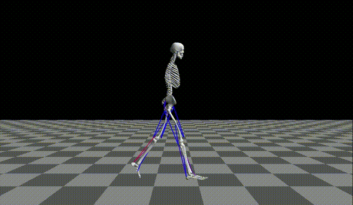

# Self-Stable Walking and Running in a Human Musculoskeletal Model through orbital stability optimization

<p align="center">
  
</p>

This repository contains the source code for the paper **"Self-stable walking and running in a human musculoskeletal model through orbital stability optimization"** by Hiroki Kitahara, Dai Owaki, and Mitsuhiro Hayashibe.

For details on the method and results, please refer to the paper.

## Repository Structure

```
musculoskeletal-gait-optimization/
├── configs/                # Optimization config files
├── experimental_data/      # Human experimental data (download separately)
├── models/                 # Musculoskeletal models (OpenSim / MJCF) and parameters
├── msk/                    # Musculoskeletal model, optimal control problem, and simulation
├── optimization_configs/   # Variable bounds, initial guesses, and symmetry definitions
└── scripts/                # Entry-point scripts
```

## Installation

To avoid dependency conflicts, we recommend setting up three separate Conda environments:

| Environment | Used for |
| --- | --- |
| Main | Optimization, simulation, and plotting |
| OpenSim | Regressing muscle kinematics, and rendering snapshots and movies |
| Pinocchio | Generating and compiling CasADi functions |

1. Install Anaconda by following the instructions on the [official website](https://www.anaconda.com/download).

2. Create the main environment (Python 3.10 or later) and install the required packages:

   ```bash
   pip install casadi pandas matplotlib scipy
   ```

3. Create an environment with OpenSim by following the [OpenSim documentation](https://opensimconfluence.atlassian.net/wiki/spaces/OpenSim/pages/53085346/Scripting+in+Python), then install the additional packages:

   ```bash
   conda install -c opensim-org pandas scipy
   pip install opencv-python
   ```

4. Create an environment with Pinocchio by following the instructions in the [Pinocchio repository](https://github.com/stack-of-tasks/pinocchio). You will also need gcc to compile the CasADi functions.

## Usage

Run all commands from the root of the repository.

### Preparation

In the **OpenSim environment**, fit polynomial approximations of the muscle lengths and moment arms:

```bash
python -m scripts.regress_muscle_kinematics models/2d_human_musculoskeletal_model/opensim_model/gait10dof18musc.osim models/2d_human_musculoskeletal_model models/2d_human_musculoskeletal_model/muscle_kinematic_parameters.json
```

In the **Pinocchio environment**, generate and compile the Pinocchio-based CasADi functions:

```bash
python -m scripts.generate_and_compile_casadi_functions models/2d_human_musculoskeletal_model/mjcf_model/2d_human_musculoskeletal_model.xml models/2d_human_musculoskeletal_model models/2d_human_musculoskeletal_model
```

### Optimization

To solve the optimal control problem that optimizes energy efficiency, run the following in the **main environment**:

```bash
python -m scripts.run_optimization energy_efficiency_optimization configs/2d_human_musculoskeletal_model/walking_efficient_soft_knitro.json
```

To solve the optimal control problem that optimizes stability, run the following in the **main environment**. This problem uses the energy-efficiency solution as its initial guess, so run the command above first.

```bash
python -m scripts.run_optimization stability_optimization configs/2d_human_musculoskeletal_model/walking_stable_soft_knitro.json
```

The solutions (`solution{i}.pkl`) and solver logs (`log{i}.txt`) are saved under `results/`.

> [!NOTE]
> Obtaining feasible solutions to the stability optimization problem requires [Artelys Knitro](https://www.artelys.com/solvers/knitro/), a commercial solver. If you just want to try out the code without Knitro, replace `*_knitro.json` with `*_ipopt.json` in each command.

### Analysis

To export the state trajectory over one gait cycle as a CSV file, run the following in the **main environment**:

```bash
python -m scripts.make_state_trajectory configs/2d_human_musculoskeletal_model/walking_efficient_soft_knitro.json results/2d_human_musculoskeletal_model/walking_efficient_soft_knitro/solution1.pkl results/2d_human_musculoskeletal_model/walking_efficient_soft_knitro/state_trajectory_1.csv
```

To plot joint angles, joint moments, ground reaction forces, cycle duration, stance duration, and muscle activations, run the following in the **main environment**:

```bash
python -m scripts.plot_gait_data -s results/2d_human_musculoskeletal_model/walking_efficient_soft_knitro/state_trajectory_1.csv -c configs/2d_human_musculoskeletal_model/walking_efficient_soft_knitro.json -o results/2d_human_musculoskeletal_model/walking_efficient_soft_knitro/gait_data.png -e
```

> [!NOTE]
> To compare the results with human experimental data, download `ProcessedData` and `Segmentation` from the [public dataset](https://doi.org/10.35090/gatech/70296), place them in the `experimental_data` directory, and run the command above without the `-e` option.

To run a forward simulation, run the following in the **main environment**:

```bash
python -m scripts.run_simulation configs/2d_human_musculoskeletal_model/walking_efficient_soft_knitro.json results/2d_human_musculoskeletal_model/walking_efficient_soft_knitro/solution1.pkl results/2d_human_musculoskeletal_model/walking_efficient_soft_knitro/simulation1.csv
```

To save snapshots, run the following in the **OpenSim environment**:

```bash
python -m scripts.take_snapshots results/2d_human_musculoskeletal_model/walking_efficient_soft_knitro/state_trajectory_1.csv models/2d_human_musculoskeletal_model/opensim_model/gait10dof18musc.osim results/2d_human_musculoskeletal_model/walking_efficient_soft_knitro/snapshots1
```

To save a movie, run the following in the **OpenSim environment**:

```bash
python -m scripts.take_movie results/2d_human_musculoskeletal_model/walking_efficient_soft_knitro/state_trajectory_1.csv models/2d_human_musculoskeletal_model/opensim_model/gait10dof18musc.osim results/2d_human_musculoskeletal_model/walking_efficient_soft_knitro/movie1
```

Run any script with `-h` to see all of its options.

## Citation

If you use this code in your research, please cite our paper:

```bibtex
@article{kitahara_self-stable,
  title   = {Self-stable walking and running in a human musculoskeletal model through orbital stability optimization},
  author  = {Kitahara, Hiroki and Owaki, Dai and Hayashibe, Mitsuhiro},
  journal = {Journal of the Royal Society Interface},
  note    = {Submitted}
}
```

## License

The source code in this repository is released under the [MIT License](LICENSE).

The MIT License does not apply to the following third-party material, which remains subject to the terms of its original distribution:

- **OpenSim model** (`models/2d_human_musculoskeletal_model/opensim_model/gait10dof18musc.osim`): the planar gait model with 10 degrees of freedom and 18 muscles (gait10dof18musc) by Ajay Seth, Frank C. Anderson, and Scott L. Delp, closely based on the lower-extremity model of Delp et al. (1990). It is distributed with OpenSim under the [Creative Commons Attribution 3.0 License (CC BY 3.0)](https://creativecommons.org/licenses/by/3.0/). See the `<credits>` and `<publications>` elements of the model file for full attribution.
- **Geometry files** (`models/2d_human_musculoskeletal_model/opensim_model/Geometry/`): bone geometry files distributed with OpenSim for visualization.
- **MJCF meshes** (`models/2d_human_musculoskeletal_model/mjcf_model/assets/*.STL`): converted from the OpenSim geometry files above. The MJCF model (`2d_human_musculoskeletal_model.xml`) was created by the authors based on the OpenSim model above.

If you use these model files, please also cite:

- S. L. Delp, J. P. Loan, M. G. Hoy, F. E. Zajac, E. L. Topp, and J. M. Rosen, "An interactive graphics-based model of the lower extremity to study orthopaedic surgical procedures", *IEEE Transactions on Biomedical Engineering* 37, 757–767 (1990).
- S. L. Delp, F. C. Anderson, A. S. Arnold, P. Loan, A. Habib, C. T. John, E. Guendelman, and D. G. Thelen, "OpenSim: open-source software to create and analyze dynamic simulations of movement", *IEEE Transactions on Biomedical Engineering* 54, 1940–1950 (2007).

## Contact

Hiroki Kitahara (kitahara.hiroki.q1@dc.tohoku.ac.jp)
